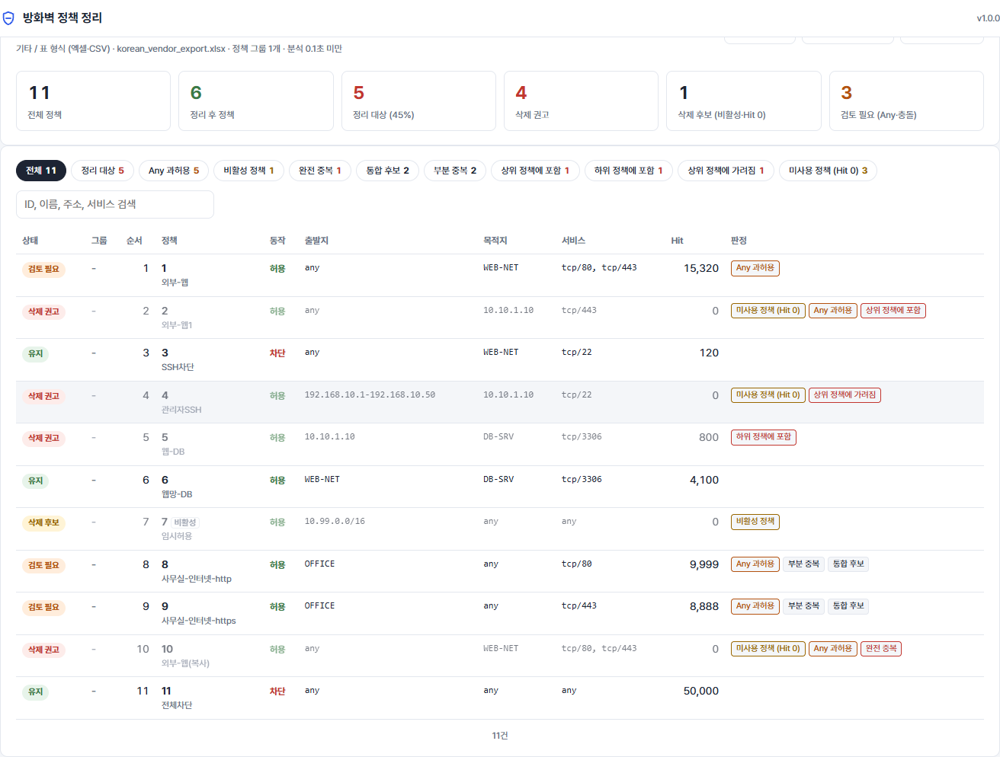
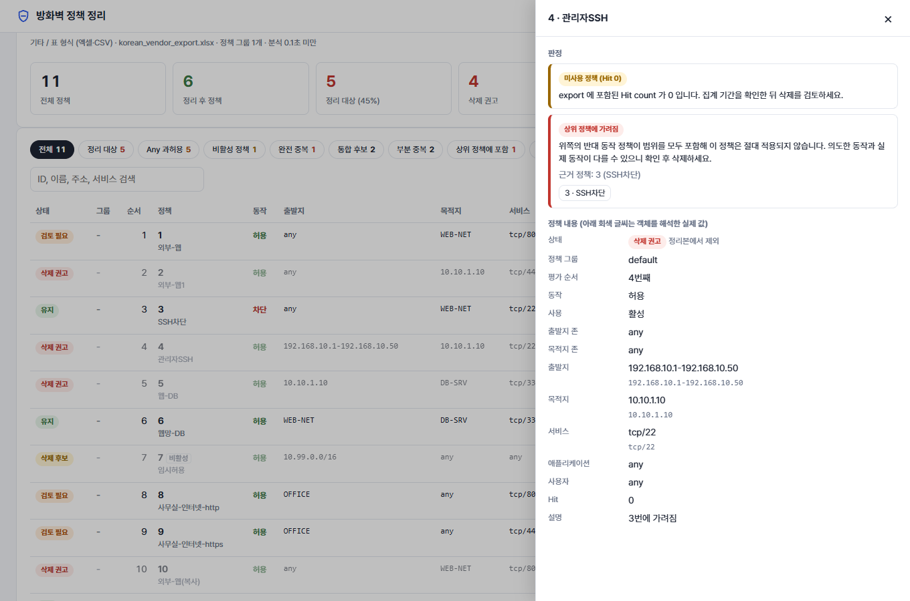

# fw-policy-cleaner

**방화벽 정책 정리 도구** — 장비에서 export 한 정책 파일을 읽어, *지워도 트래픽 처리 결과가 바뀌지 않는* 중복·불필요 정책을 찾아내고 리포트와 정리 명령어를 만들어 줍니다.

> A local web tool that analyzes exported firewall rulebases (Palo Alto, FortiGate, Cisco ASA, Juniper SRX/ScreenOS, Check Point, Korean vendors) and finds redundant, shadowed and over-permissive rules — only flagging a rule for removal when doing so provably does not change first-match behavior.



## 특징

- **first-match 의미 보존** — 방화벽은 위에서부터 처음 매칭되는 정책을 적용합니다. 이 전제를 모델링해서,
  삭제해도 어떤 트래픽의 처리 결과도 달라지지 않는 정책만 "삭제 권고"로 판정합니다.
  무작위 정책 집합으로 정리 전후 동작이 같은지 검증하는 테스트가 포함되어 있습니다.
- **실제 주소·포트 집합 연산** — CIDR, 범위, 와일드카드, 객체 그룹(중첩)을 정수 구간으로 계산해 포함·겹침을 판정합니다.
  FQDN·동적 그룹처럼 값을 알 수 없는 객체는 *이름이 같을 때만 같다*고 보는 보수적 판정이라 오판으로 정책을 지우지 않습니다.
- **여러 벤더 지원** — 설정 파일을 직접 파싱하거나(객체 해석 포함), 엑셀/CSV export 의 열 이름을 자동 인식합니다.
- **빠름** — 목적지 대역 인덱스로 비교 후보를 줄여 정책 1만 개를 약 1초에 분석합니다.
- **로컬 전용** — `127.0.0.1` 에만 바인딩하고, 업로드한 파일은 메모리에서만 처리합니다. 설정 파일이 외부로 나가지 않습니다.

## 빠른 시작

Python 3.10 이상이 필요합니다.

```bash
git clone <this-repo>
cd fw-policy-cleaner
python -m venv .venv
.venv\Scripts\activate          # macOS/Linux: source .venv/bin/activate
pip install -r requirements.txt
python run.py                   # 브라우저가 http://127.0.0.1:8765 로 열립니다
```

Windows 에서는 `start.bat` 을 실행하면 위 과정을 자동으로 처리합니다.
`samples/` 폴더의 가상 설정 파일로 바로 써볼 수 있습니다.

## 지원 입력

| 벤더 | 입력 형식 | 상태 |
|---|---|---|
| Palo Alto (PAN-OS / Panorama) | XML 설정 (`show config running`) | ✅ |
| Palo Alto | 웹 UI 정책 CSV export | ✅ 열 자동 인식 |
| Fortinet FortiGate | 설정 백업 `.conf` (멀티 VDOM) | ✅ |
| Cisco ASA / FTD | `show running-config` (+ `show access-list` 를 붙이면 hit count 반영) | ✅ |
| Juniper SRX | `show configuration \| display set` | ✅ |
| Juniper ScreenOS (NetScreen / SSG) | `get config` | ✅ |
| 웹 화면 정책 목록 복사본 | 시트별 `From X To Y` 제목 + ID/Source/Destination/Service 표 | ✅ |
| Check Point | SmartConsole CSV/Excel export | ⚠️ 실제 export 미검증 |
| SECUI / AXGATE / AhnLab TrusGuard / WINS SNIPER | 관리 화면 정책 목록 엑셀/CSV | ⚠️ 실제 export 미검증 |
| 기타 표 형식 | 출발지·목적지·서비스·동작 열이 있는 엑셀/CSV | ✅ |

표 형식 입력은 한글/영문 열 이름을 자동 인식하고, 틀리면 화면에서 열을 직접 지정할 수 있습니다.
셀 하나에 여러 값이 있거나(줄바꿈 / `;` / `,`), 한 정책이 여러 행에 걸친 형태도 읽습니다.
같은 파일에 주소 객체 시트가 있으면 객체도 해석하고, 없으면 이름에 들어 있는 IP(`10.1.1.5_WEB`)를 사용합니다.

⚠️ 표시된 벤더는 공개된 export 형식 정보가 부족해 열 자동 인식에 의존합니다. 실제 export 샘플(민감 정보를 지운 것)을
이슈로 공유해 주시면 전용 파서를 추가하겠습니다.

## 판정 기준

| 분류 | 판정 | 의미 |
|---|---|---|
| 삭제&nbsp;권고 | 완전&nbsp;중복 | 위쪽에 조건·동작이 같은 정책이 있음 |
| 삭제&nbsp;권고 | 상위&nbsp;정책에&nbsp;포함 | 위쪽 같은 동작 정책이 범위를 모두 포함 → 절대 매칭되지 않음 |
| 삭제&nbsp;권고 | 상위&nbsp;정책에&nbsp;가려짐 | 위쪽 **반대 동작** 정책이 범위를 모두 포함 → 의도와 실제 동작이 다를 수 있음 |
| 삭제&nbsp;권고 | 하위&nbsp;정책에&nbsp;포함 | 아래쪽 같은 동작 정책이 포함하고, 그 사이에 겹치는 반대 동작 정책이 없음 |
| 삭제&nbsp;권고 | 상위&nbsp;정책에&nbsp;포함<br>(동작&nbsp;미확인) | export 에 동작 정보가 없을 때, 동작과 무관하게 확실한 경우만 |
| 삭제&nbsp;후보 | 비활성&nbsp;/&nbsp;미사용(Hit&nbsp;0) | 운영 확인 후 삭제 |
| 검토&nbsp;필요 | Any&nbsp;과허용<br>부분&nbsp;중첩&nbsp;충돌 | 보안 검토 대상 |
| 참고 | 부분&nbsp;중복<br>통합&nbsp;후보 | 객체 단위 정리 또는 정책 통합 가능 |

판정의 안전성을 위한 규칙:

- 두 단계(위→아래, 아래→위) 모두 *남아 있는 정책만* 근거로 삼아, 서로를 근거로 둘 다 지우는 일이 없습니다.
- 맨 아래의 `any any any` 정책(Cleanup)을 근거로 다른 정책을 "하위 정책에 포함"으로 판정하지 않습니다.
- 부정(negate)·제외 조건이 있는 정책은 분석에서 제외하되, 다른 정책을 판정할 때는 *겹칠 수 있다*고 가정합니다.
- 다른 정책을 10개 이상 가리는 정책은 "주요 근거 정책"으로 따로 표시합니다 (중간에 낀 any 정책 등).



## 결과물

- **엑셀 리포트** — 요약, 전체 정책, 정리 대상, 검토 필요, 통합 후보 시트
- **정리된 정책 파일** — 표 형식 입력일 때, 원본과 같은 열 구조에서 정리 대상을 뺀 엑셀
- **정리 명령어** — PAN-OS / FortiOS / ASA / Junos / ScreenOS / Check Point(mgmt_cli) 용
  *비활성화 → 모니터링 → 삭제* 2단계 명령. CLI 가 없는 벤더는 정리 대상 목록

> 생성된 명령어는 검토용 초안입니다. 반드시 설정을 백업하고 변경 절차에 따라 적용하세요.

## 구조

```
fwclean/
  sets.py        주소·포트 구간 집합 연산 (포함 / 겹침)
  model.py       벤더 중립 정책 모델, 객체·그룹 해석
  parsers/       벤더별 파서 (paloalto, fortigate, cisco_asa, juniper_srx, screenos, tabular)
  analyzer.py    판정 엔진 (first-match 기반, 목적지 대역 인덱스)
  report.py      JSON / 엑셀 리포트 / 정리본 / 장비 명령어
  web/           Flask 로컬 웹 UI
tests/           파서·판정 회귀 테스트, 정리 전후 동작 동일성 검증
samples/         가상 설정 파일 (tools/make_samples.py 로 재생성)
```

## 개발

```bash
pip install -r requirements.txt
python -m pytest -q
python tools/make_samples.py     # 표 형식 샘플 재생성
```

## 보안 주의

실제 장비 설정은 네트워크 구조가 드러나는 민감 정보입니다. 이슈나 PR 에 실제 설정을 올리지 마세요.
샘플이 필요하면 IP·객체명·호스트명을 가상 값으로 바꾼 뒤 공유해 주세요.

## License

MIT
